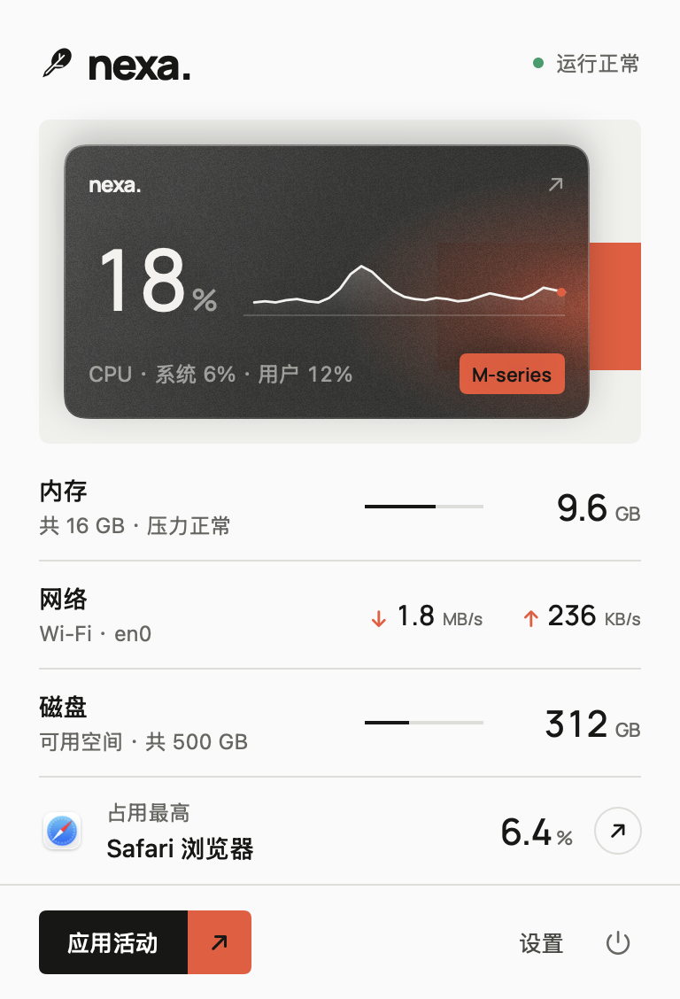
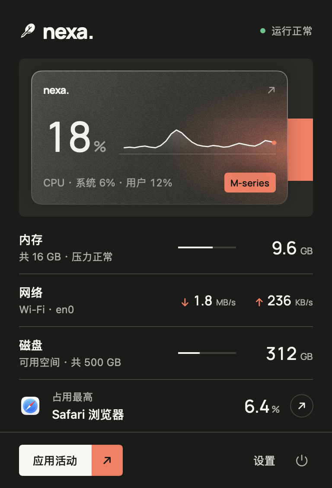
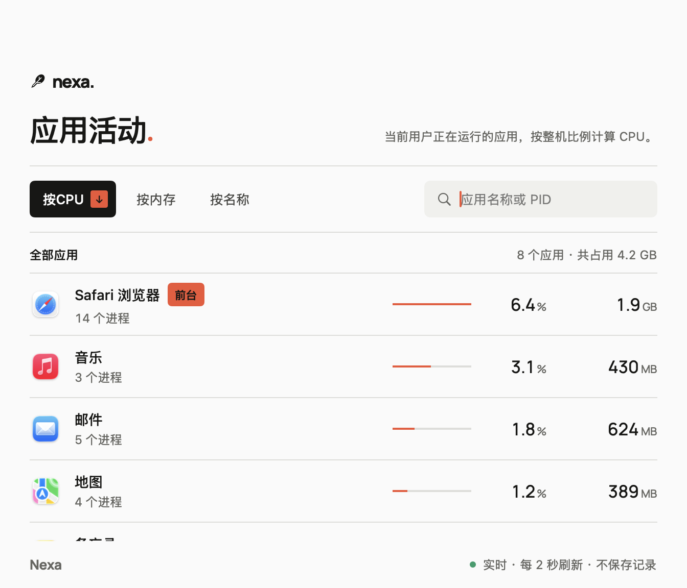

# nexa for Mac

Mac 菜单栏里的系统状态小工具，界面与 [nexastore.cn](https://nexastore.cn) 同一套视觉。原生 Swift + SwiftUI + AppKit，无第三方代码依赖。

<p>
  
  
</p>


## 功能

- CPU（带最近 60 秒趋势线）、内存、网络、磁盘，以及此刻占用 CPU 最多的应用。
- 应用活动窗口：实时查看各应用的 CPU 和内存，可搜索、排序；只做实时查看，不保存任何记录。
- 菜单栏可只显示羽毛，或附带 CPU / 内存读数；支持浅色、深色和三档界面大小。
- 不联网、不上传数据，不需要管理员或辅助功能等权限。

## 构建

需要 Apple Silicon Mac、Xcode Command Line Tools 和 macOS 14 以上 SDK。

```bash
bash NexaSource/build.sh
```

产物（`Nexa.app`、`Nexa-macOS.zip`、`nexa-icon.png`）输出到仓库根目录。应用为 ad-hoc 签名，未经 Apple 公证，第一次打开的方法见[使用说明](docs/使用说明.md#安装)。

不想自己构建的话，可以从 [Releases](https://github.com/Tumblr-code/nexa-mac/releases) 下载打包好的应用。

截图用固定的示例数据生成，不来自任何真实机器：

```bash
NEXA_PREVIEW_DEMO=1 ./Nexa.app/Contents/MacOS/Nexa --render-previews docs/screenshots
```

## 文档

- [使用说明](docs/使用说明.md)
- [开发说明](docs/开发说明.md)：源码结构、测试和验证命令、设计与实现的边界

字体 Manrope 按 SIL Open Font License 随附，见 `NexaSource/Assets/Manrope-OFL.txt`。
